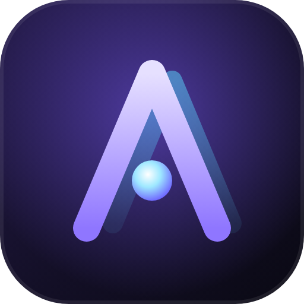

<div align="center">



# ALTTER

**Your personal AI — on the subscriptions you already pay for.**

Plug in Claude, ChatGPT or Gemini *with your normal account* (no API keys) and get one assistant on your computer **and** your phone. It remembers you, runs agents in the background, builds websites and videos, uses your apps like a person and generates images. Free and open source, no account, no cloud of ours.

**[Website](https://qwtr.github.io/alter/)** · **[⬇ Windows installer](https://github.com/QWTR/alter/releases/latest/download/ALTTER-Setup.exe)** · **[⬇ Android app (APK)](https://github.com/QWTR/alter/releases/latest/download/ALTTER.apk)** · [Polski ↓](#-po-polsku)

</div>

---

## What it does

**Chat on your own subscriptions.** ALTTER drives the vendors' official CLIs (Claude Code, OpenAI Codex, Gemini CLI) logged in with *your* account. Your subscription, your limits, no extra bill. You can switch AI mid-conversation; when one runs out of its limit, ALTTER asks or moves to another.

**Memory.** After every chat and agent run ALTTER keeps the durable facts (who you are, projects, people, habits) and uses them next time. You can see, edit and delete every memory.

**Agents and groups.** Agents work on a schedule (morning brief, inbox triage, reel ideas…) and build on their own previous runs. Put several of them in a group, even on different AIs: mention the group with `@` and the lead splits the task.

**Studio.** Websites with a **live preview** you can click into: pick an element and say what to change, also from your phone. Reels, motion graphics, 3D, edits, captions and thumbnails from one sentence, using a built-in kit of scenes and effects, so the AI writes less and it looks better.

**Agents on your screen.** With *Full control* they use the computer like a person, with mouse, keyboard and any app (Blender, Excel, the browser…). Each one has its own visible, named cursor.

**Images & video.** Describe it, pick a format, done:
- Images are free (Pollinations) with no key needed.
- With your own key you get FLUX, Kling, Veo (fal.ai), GPT Image (OpenAI) and Gemini image.
- The AI in any chat can generate them too.
- Everything lands in one gallery on your computer.

**Prompt library.** Ready prompts and your own, with `{{blanks}}` to fill in. One tap sends one to a chat or to Images & video.

**Usage.** Tokens used by Claude Code, Codex and Gemini CLI on this computer, per day, model and project, plus what the same would cost on the API. It is read from their own local logs, and nothing leaves the computer.

**Projects.** Each project has its own chats, agents, memory and a real folder. Import a folder, a git repo or a link and every chat starts already knowing the project.

**Automations.** ALTTER watches sites, servers, ports or any command, and the checks themselves cost no AI. When something breaks, an agent wakes up, diagnoses it from your computer and fixes it or tells you exactly what to do.

**Phone app.** A native Android app shows everything on your computer, live in both directions:
- Pair it by scanning a QR code.
- At home it connects directly over Wi-Fi; away from home it goes through your own relay.
- Dictation and voice conversation work in it too.

**Also:** trips (real flights and stays compared), plugins (Figma, Blender, a real browser, GitHub, Notion… one click), shared online sessions on a chat, and six UI languages (English, Polski, Deutsch, Español, Français, Українська).

**Access levels.** Every chat and agent runs as *Chat only*, *Read files & web* or *Full control*, and you choose which.

## Install

### Windows
1. Download **[ALTTER-Setup.exe](https://github.com/QWTR/alter/releases/latest/download/ALTTER-Setup.exe)** and run it.
2. Pick any drive. ALTTER keeps its data and projects next to the program, and updates or uninstalling never delete them.
3. It installs per user (no admin), starts with Windows in the tray and keeps agents running.

The first-run setup connects your AI and tests it for real. The installer is not code-signed yet, so SmartScreen may ask: *More info → Run anyway*.

### Android
1. Download **[ALTTER.apk](https://github.com/QWTR/alter/releases/latest/download/ALTTER.apk)** on the phone and allow installing from your browser.
2. On the computer open ALTTER → Settings → Devices → *Connect a phone*.
3. In the app tap *Scan the QR code*. That is all: the QR carries the address too.

### AI subscriptions
You need at least one AI CLI signed in with your account. ALTTER can also open the install and sign-in terminal for you from Settings → AI connections.

| Subscription | Install | Sign in |
|---|---|---|
| Claude Pro / Max | `npm i -g @anthropic-ai/claude-code` | run `claude`, then `/login` |
| ChatGPT Plus / Pro | `npm i -g @openai/codex` | `codex login` → *Sign in with ChatGPT* |
| Google AI Pro / free Google account | `npm i -g @google/gemini-cli` | run `gemini` → *Login with Google* |

### From source
Requires Node.js 24+.

```bash
git clone https://github.com/QWTR/alter.git
cd alter
npm install
npm start                          # web UI on http://localhost:7420
npm run desktop                    # desktop app (window + tray)
npm run dist -w @alter/desktop     # Windows installer → apps/desktop/release/
cd apps/mobile && npm install && npm run apk   # Android APK (needs Android Studio's SDK)
```

## How it works

```
 ┌──────────── your computer (the hub) ──────────────┐            ┌──── phone ────┐
 │  Desktop shell (Electron) ─ tray, overlay cursors │   Wi-Fi    │ ALTTER app    │
 │  ALTTER core ── HTTP + SSE API, device tokens     │◀─────────▶ │ (same UI,     │
 │   ├─ providers ─▶ claude -p │ codex exec │ gemini │  or your   │  live sync)   │
 │   ├─ memory + learning (SQLite)                   │   relay    └───────────────┘
 │   ├─ agents, groups, scheduler, automations       │
 │   ├─ MCP tools for the AI: team, screen, media    │
 │   └─ studio (sites, video, 3D), media, prompts    │
 └───────────────────────────────────────────────────┘
```

- **Providers** (`packages/core/src/providers`) spawn the official CLI and stream the answer back. ALTTER never sees your credentials; each CLI keeps its own login.
- **Tools for the AI** are small MCP servers inside core (`/mcp/team`, `/mcp/hands`, `/mcp/media`). They are loopback-only and get a fresh token per run.
- **Sync**: the computer is the source of truth. Devices pair with a one-time code (or QR) and get their own revocable token. Every change is pushed to all devices over Server-Sent Events.
- **Relay** (`apps/relay`): an optional tiny forwarder on a server of your own. It stores nothing and lets the phone reach the computer from anywhere.

### A note on terms of service
ALTTER only automates the official CLIs on *your own machine, for you*, which is the same as typing in a terminal. It never extracts tokens or shares your subscription with other people. Respect each vendor's limits and terms.

## Project layout

```
packages/core   the daemon: providers, memory, agents, studio, media, API (TypeScript on Node 24)
apps/web        the UI (React + Vite + Motion), translated in apps/web/src/i18n, used by desktop and phone
apps/desktop    Electron shell: window, tray, on-screen agent cursors, installer
apps/mobile     Android app (Capacitor)
apps/relay      optional relay for reaching your computer from anywhere
studio-kit      the scene and effects kit the Studio renders videos with
skills/         built-in skills (Markdown instruction packs)
docs/           the website (GitHub Pages)
```

## Contributing
PRs welcome. `npm run typecheck` should pass. New providers implement the `Provider` interface in `packages/core/src/providers/types.ts`.

---

## 🇵🇱 Po polsku

**ALTTER** to Twoje osobiste AI na subskrypcjach, które już masz. Claude, ChatGPT albo Gemini podłączasz **zwykłym logowaniem do konta, bez kluczy API**. Działa na komputerze i na telefonie, za darmo, open source, bez naszego konta i bez naszej chmury.

**Pobierz:** [instalator na Windows](https://github.com/QWTR/alter/releases/latest/download/ALTTER-Setup.exe) · [aplikacja na Androida (APK)](https://github.com/QWTR/alter/releases/latest/download/ALTTER.apk) · [strona](https://qwtr.github.io/alter/)

- **Pamięć:** ALTTER uczy się Ciebie z rozmów i pracy agentów. Wszystko możesz podejrzeć i usunąć.
- **Agenci i grupy:** pracują w tle według harmonogramu. Grupę wołasz przez `@`, a lider dzieli zadanie.
- **Studio:**
  - Strony z podglądem na żywo: klikasz element i mówisz, co zmienić, także z telefonu.
  - Rolki, motion graphics i 3D z jednego zdania.
- **Agenci na ekranie:** z *Pełną kontrolą* AI używa komputera jak człowiek (Blender, Excel, przeglądarka), a każdy agent ma swój widoczny kursor.
- **Obrazy i wideo:**
  - Obrazy są za darmo, bez klucza.
  - Na własnym kluczu dostajesz FLUX, Kling, Veo, GPT Image i Gemini.
  - AI w czacie też je generuje.
- **Biblioteka promptów** z polami do uzupełnienia.
- **Zużycie:** tokeny z Claude Code, Codex i Gemini CLI na tym komputerze.
- **Projekty i automatyzacje:** pilnują stron i serwerów, a jak coś padnie, agent sam to diagnozuje i naprawia.
- **Telefon:**
  - Parowanie skanem kodu QR.
  - Wszystko na żywo w obie strony.
  - W domu łączy przez Wi-Fi, poza domem przez Twój relay.

Instalacja: uruchom instalator, potem w ALTTER otwórz Ustawienia → Urządzenia → *Połącz telefon* i zeskanuj kod w aplikacji.

## License
[AGPL-3.0](LICENSE) © ALTTER contributors
